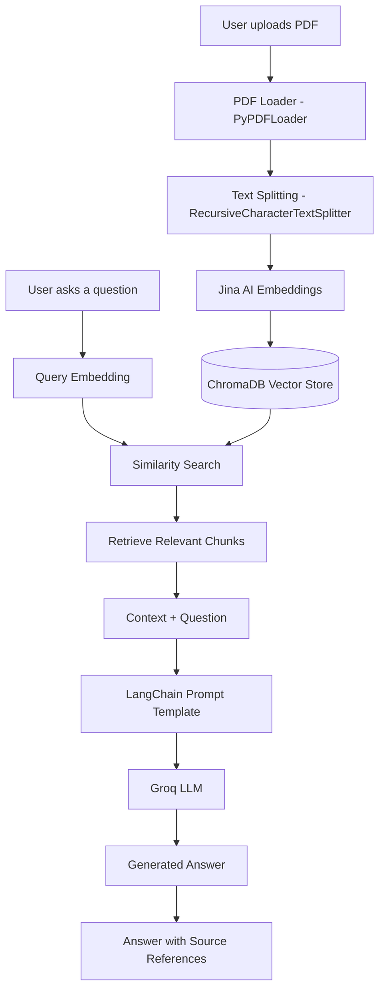

# 💹 FinSight AI — Financial Intelligence RAG

**An AI-powered financial document assistant built using Retrieval-Augmented Generation (RAG), LangChain, Groq, Jina AI, and ChromaDB.**

FinSight AI allows users to upload financial PDF documents and ask questions about their contents using natural language. It retrieves relevant information from the uploaded documents and generates context-aware answers with source references.

🌐 **Live Demo:** [Try FinSight AI](https://finsightai-0555.streamlit.app/)

---

## 🚀 Overview

Understanding lengthy financial documents, reports, and educational materials can be time-consuming.

FinSight AI simplifies this process by combining semantic search with Large Language Models (LLMs).

Instead of relying entirely on an LLM's internal knowledge, the application retrieves relevant document passages and uses them as context to generate answers.

**What makes it useful?**
- Upload financial PDF documents directly through the application.
- Ask questions in natural language.
- Retrieve relevant information using semantic similarity search.
- Generate context-aware answers using an LLM.
- View source document names and page references.
- Handle questions whose answers are not available in the uploaded documents.

---

## 🏗️ System Architecture

FinSight AI follows a Retrieval-Augmented Generation (RAG) architecture.



### Architecture Components

| Component | Technology | Purpose |
|---|---|---|
| Frontend | Streamlit | User interface and PDF uploads |
| PDF Loading | PyPDFLoader | Extract text and metadata from PDFs |
| Text Splitting | RecursiveCharacterTextSplitter | Divide documents into manageable chunks |
| Embeddings | Jina AI | Convert text into vector representations |
| Vector Database | ChromaDB | Store and retrieve document embeddings |
| LLM | Groq | Generate natural language responses |
| Orchestration | LangChain | Connect retrieval, prompts, and LLM |
| Deployment | Streamlit Community Cloud | Host the application |

---

## ⚙️ How It Works

FinSight AI operates through two main stages:

### 1. Document Ingestion and Indexing

When a user uploads a PDF:

1. **PDF Loading:** PyPDFLoader extracts text from the PDF while preserving page metadata.
2. **Text Chunking:** RecursiveCharacterTextSplitter divides the extracted text into smaller, overlapping chunks.
3. **Embedding Generation:** Jina AI converts each chunk into a numerical vector representation.
4. **Vector Storage:** ChromaDB stores the vectors along with their corresponding text and metadata.
5. **Duplicate Prevention:** Stable content-based IDs help avoid storing duplicate chunks.

### 2. Question Answering and Retrieval

When a user asks a question:

1. **Query Processing:** The question is converted into an embedding using Jina AI.
2. **Similarity Search:** ChromaDB searches for the most relevant document chunks.
3. **Context Retrieval:** The top relevant chunks are passed to the RAG pipeline.
4. **Prompt Construction:** LangChain combines the retrieved context with the user's question.
5. **Response Generation:** Groq's LLM generates an answer based on the supplied context.
6. **Source Attribution:** The application displays relevant document names and page references.

This approach helps reduce hallucinations by grounding answers in the uploaded documents.

---

## ✨ Key Features

- **PDF Upload:** Upload financial documents directly through the web interface.
- **Semantic Search:** Retrieve information based on meaning rather than exact keyword matching.
- **Context-Aware Responses:** Generate answers using relevant document content.
- **Source References:** Display document names and page numbers for retrieved information.
- **Hallucination Awareness:** Instruct the model to acknowledge when information is unavailable in the provided context.
- **Interactive Chat Interface:** Ask multiple questions through a conversational interface.
- **Duplicate Chunk Prevention:** Avoid unnecessary re-indexing of existing content.
- **Cloud Deployment:** Access the application through a web browser.

---

## 🛠️ Tech Stack

**Programming Language**
- Python 3.12

**Generative AI and RAG**
- LangChain
- Groq API
- Jina AI Embeddings

**Document Processing**
- PyPDF
- PyPDFLoader
- RecursiveCharacterTextSplitter

**Vector Database**
- ChromaDB

**Frontend and Deployment**
- Streamlit
- Streamlit Community Cloud

**Development Tools**
- VS Code
- uv (Python package and project management)
- Git and GitHub

---

## 📂 Project Structure

```text
FinSightAI/
│
├── .streamlit/
│   └── config.toml
│
├── app/
│   └── streamlit_app.py
│
├── data/
│   ├── raw/
│   ├── processed/
│   └── chroma_db/
│
├── src/
│   └── finsightai/
│       ├── __init__.py
│       ├── config.py
│       ├── ingestion.py
│       ├── embeddings.py
│       ├── vectorstore.py
│       ├── retrieval.py
│       ├── prompts.py
│       └── rag_chain.py
│
├── main.py
├── pyproject.toml
├── requirements.txt
├── uv.lock
├── .gitignore
└── README.md
```

---

## 💻 Run Locally

### Prerequisites

- Python 3.12
- Git
- uv
- Groq API Key
- Jina AI API Key

### 1. Clone the repository

```bash
git clone https://github.com/PiyushamSrivastava/FinSightAI.git
cd FinSightAI
```

### 2. Create and activate the environment

```bash
uv sync
```

### 3. Configure environment variables

Create a `.env` file in the project root:

```env
GROQ_API_KEY=your_groq_api_key
JINA_API_KEY=your_jina_api_key
```

Never commit your `.env` file or expose API keys publicly.

### 4. Launch the application

```bash
uv run streamlit run app/streamlit_app.py
```

The application will open in your browser.

---

## 🔐 Security and Configuration

- API keys are stored as environment variables locally.
- Streamlit Cloud secrets are used for deployed API credentials.
- Sensitive configuration files and local database files should not be committed to GitHub.

---

## ⚠️ Current Limitations

- Text-based PDFs are supported; scanned PDFs requiring OCR are not currently supported.
- Answer quality depends on the quality and completeness of uploaded documents.
- The system is designed for document-grounded information retrieval, not financial forecasting.
- It does not provide personalized investment recommendations.
- The deployed application's local storage may not persist across application restarts or redeployments.

---

## 🔮 Future Improvements

- Support for Excel files, CSVs, and financial reports.
- Conversational memory for follow-up questions.
- Advanced retrieval techniques such as hybrid search and reranking.
- Document-level management and deletion.
- Improved evaluation using RAGAS or other RAG evaluation methods.
- Persistent cloud-based vector storage.
- Multi-document comparison and financial report analysis.

---

## 🎯 Learning Outcomes

Building FinSight AI provided practical experience with:

- Understanding and implementing Retrieval-Augmented Generation.
- Building document ingestion and chunking pipelines.
- Working with embedding models and vector databases.
- Implementing semantic similarity search.
- Integrating LLMs with LangChain.
- Designing context-grounded prompts.
- Building interactive GenAI applications using Streamlit.
- Deploying an AI application using cloud hosting.

---

## 👨‍💻 Author

**Piyusham Srivastava**

B.Tech Computer Science and Engineering Student | AI & Machine Learning Enthusiast

- GitHub: [@PiyushamSrivastava](https://github.com/PiyushamSrivastava)
- LinkedIn: [Piyusham Srivastava](https://www.linkedin.com/in/piyusham-srivastava-800850327/)

---

⭐ If you find this project interesting, consider giving the repository a star!

**Built with Python, LangChain, and Generative AI.**
